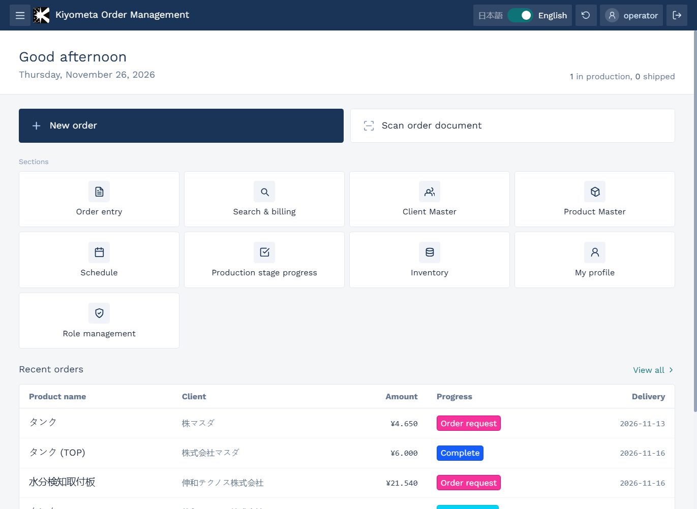
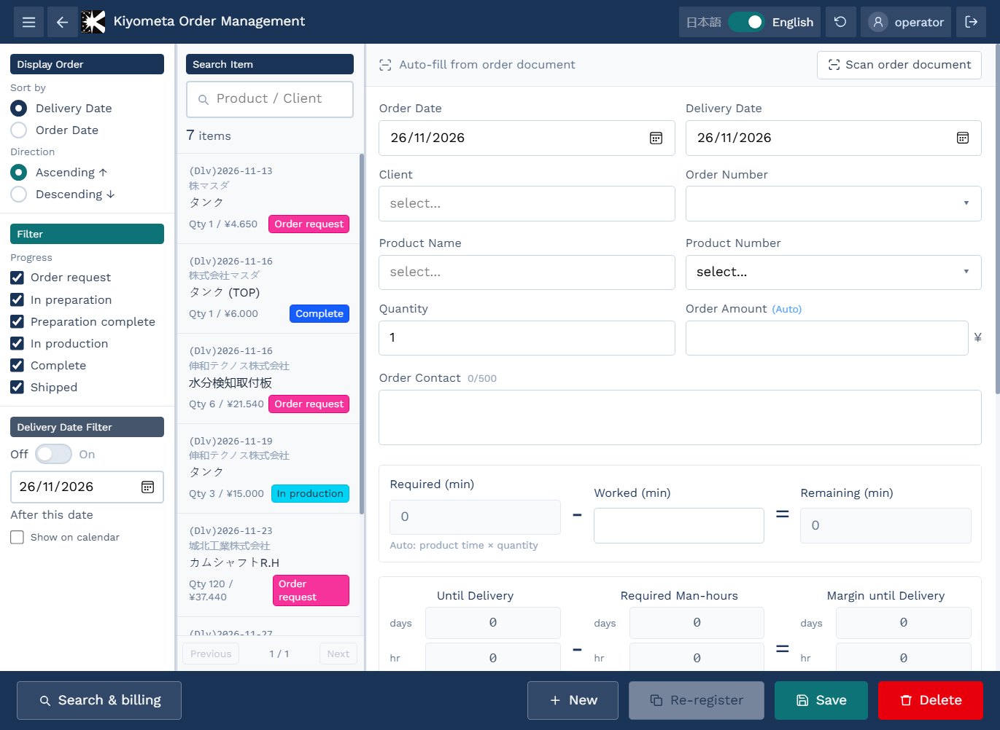
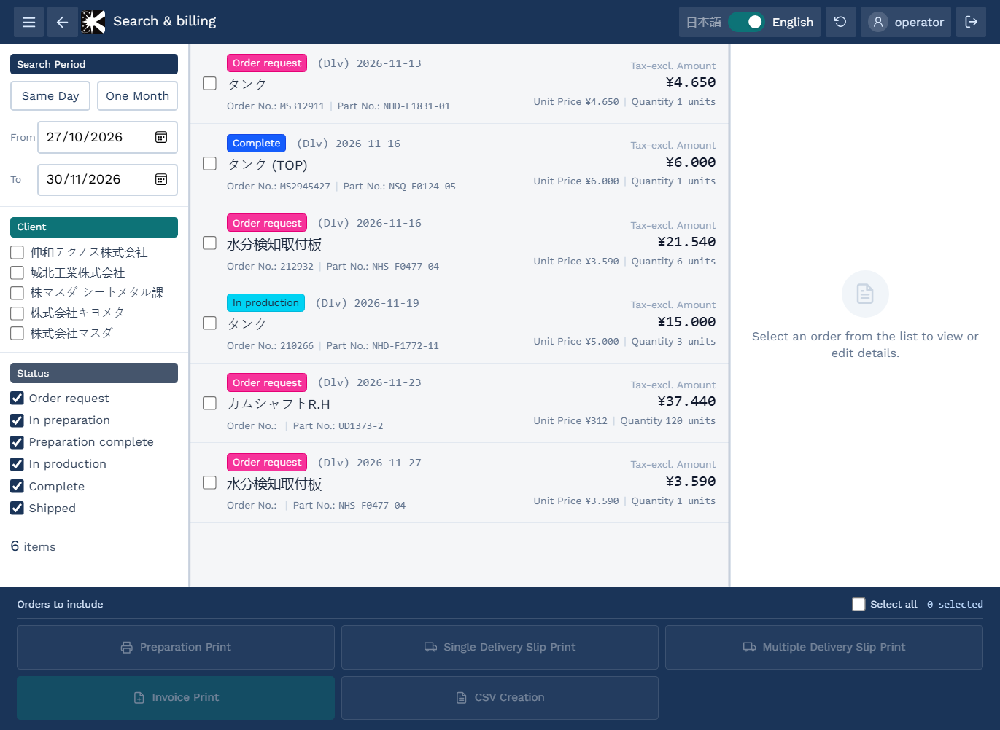
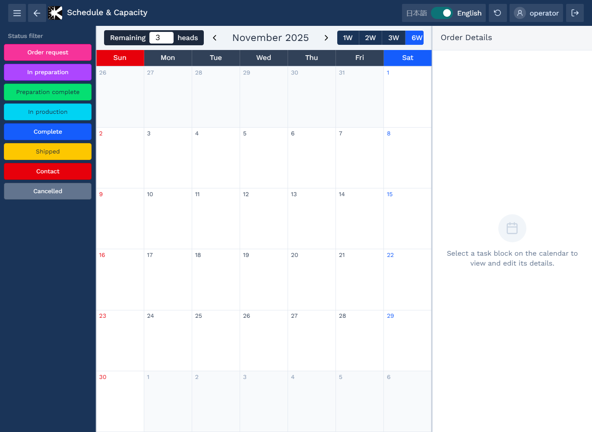
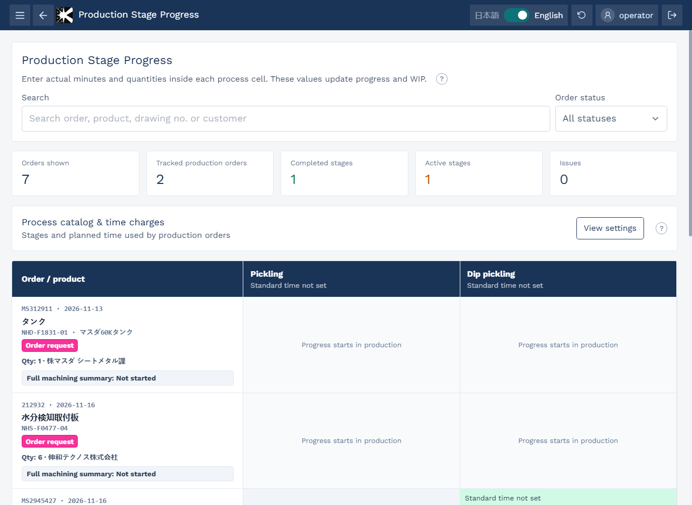
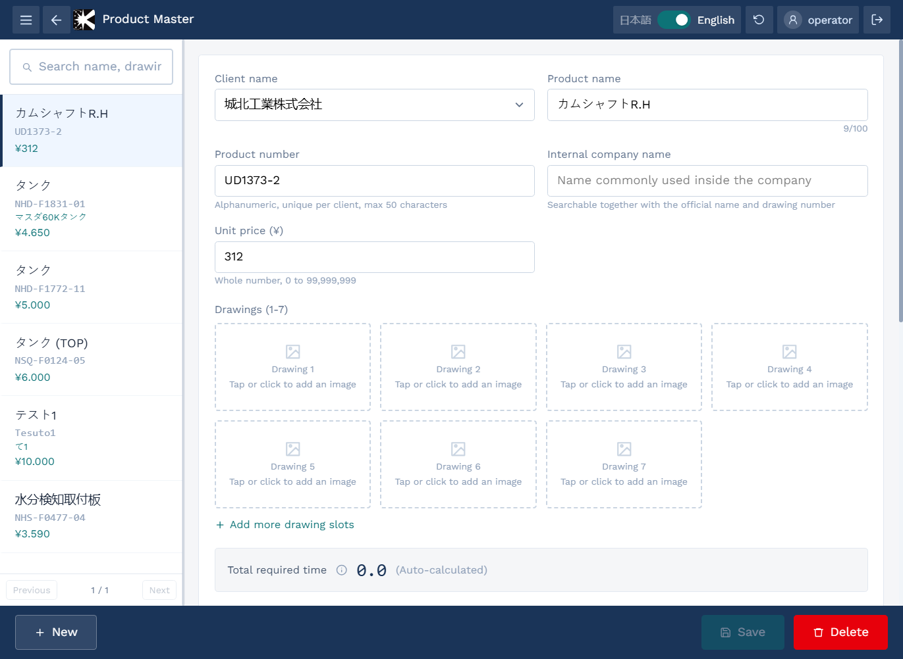
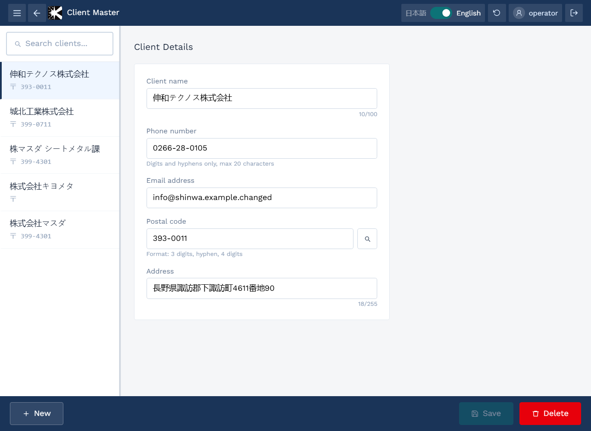
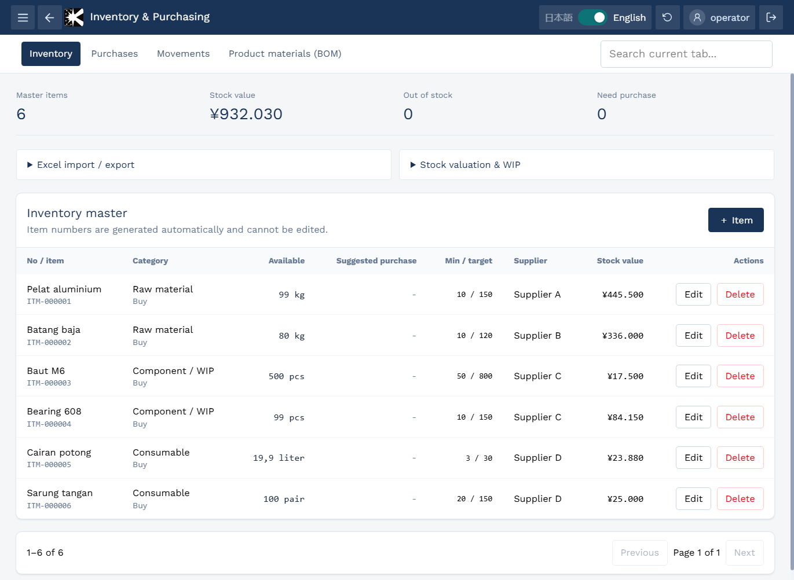
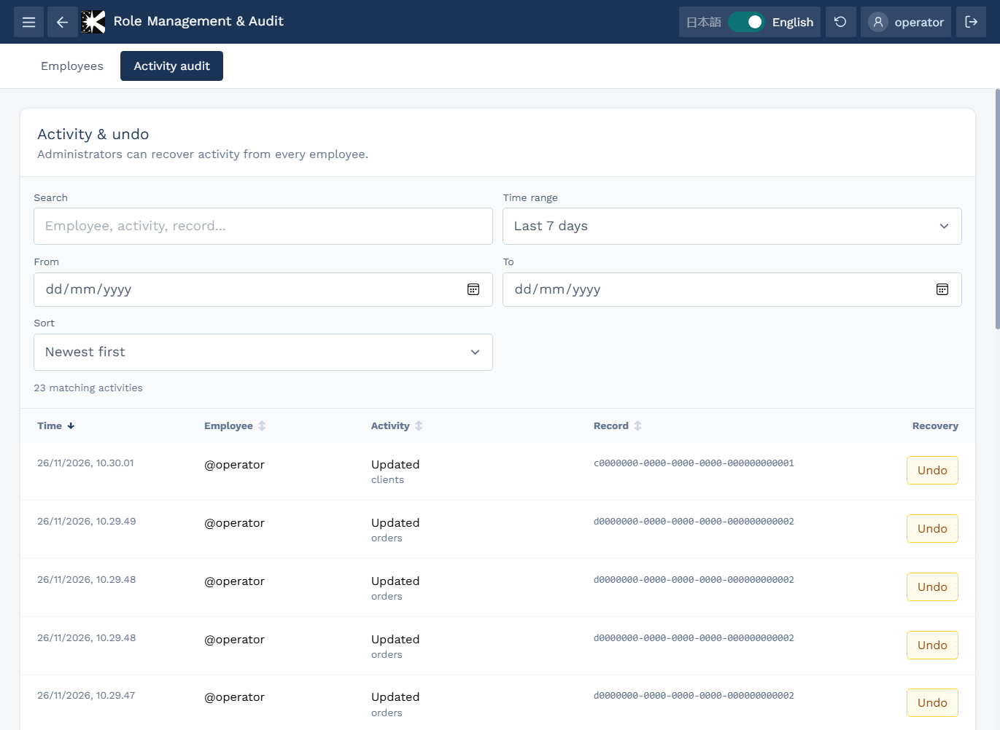

# Kiyometa Order Management

Kiyometa adalah aplikasi web untuk mengelola kegiatan manufaktur pada perusahaan baja Jepang. Aplikasi ini menggantikan software tablet lama dan menyatukan data quotation, order, produksi, BOM, dan inventory pada beberapa tablet.

## Modul

| Modul | Fungsi |
|---|---|
| Home | Ringkasan aktivitas dan akses modul |
| Quotation dan Order Entry | Membuat quotation dan mendaftarkan order |
| Search & Billing | Mencari order, mencetak dokumen, dan membuat CSV |
| Calendar | Melihat order berdasarkan tanggal |
| Production Stage Progress | Melihat dan memperbarui tahap produksi |
| Product Master | Mengelola produk, BOM, drawing, dan manufacturing process |
| Client Master | Mengelola data client |
| Inventory & Purchasing | Mengelola material, pembelian, stock movement, dan rekonsiliasi |
| Role Management | Mengelola employee dan role |
| Activity Audit | Melihat riwayat perubahan dan melakukan undo jika diizinkan |

## Alur utama

1. Staff menerima quotation dari client.
2. Staff memakai OCR untuk membaca dokumen.
3. Staff memeriksa hasil OCR dan membuat quotation atau order.
4. BOM menghubungkan produk dengan material.
5. Saat order masuk produksi, inventory berkurang sesuai BOM.
6. Staff memantau produksi dan mencetak dokumen.
7. Activity Audit menyimpan siapa yang mengubah data dan kapan perubahan terjadi.

## OCR dan offline

OCR memakai Python, FastAPI, RapidOCR, dan OpenCV. Staff dapat crop atau rotate dokumen, memeriksa hasil pembacaan, lalu memperbaiki field sebelum data masuk ke order. Panduan lengkap ada di [ocr-service/README.md](ocr-service/README.md).

Aplikasi menyimpan draft dan recovery event di IndexedDB. Aplikasi dapat melanjutkan OCR job dan mengirim submission saat koneksi pulih. Panduan recovery ada di [docs/recovery.md](docs/recovery.md).

## Screenshot showcase

Screenshot disimpan di [docs/screenshots/](docs/screenshots/). Gunakan nama modul berikut saat menambahkan capture:











## Technology

React, TypeScript, dan Vite menjalankan web app. Supabase menyediakan authentication, PostgreSQL, file storage, dan Edge Functions. FastAPI menjalankan OCR service. Flutter menyediakan Android tablet wrapper. IndexedDB menyimpan draft dan recovery lokal.

## Folder project

- [webapp/](webapp/) berisi React application.
- [backend/](backend/) berisi migration dan Supabase Edge Functions.
- [ocr-service/](ocr-service/) berisi OCR service Python.
- [lib/](lib/), [android/](android/), dan [web/](web/) berisi Flutter wrapper.
- [deploy/](deploy/) berisi konfigurasi deployment.
- [docs/](docs/) berisi panduan developer dan operasi.

## Menjalankan web app

1. Install Node.js.
2. Salin template environment.
3. Isi URL dan publishable key Supabase.
4. Install dependency dan jalankan Vite.

```powershell
Copy-Item webapp/.env.local.example webapp/.env.local
cd webapp
npm ci
npm run dev
```

Isi VITE_SUPABASE_URL dan VITE_SUPABASE_PUBLISHABLE_KEY di webapp/.env.local. Jangan masukkan database password atau service role key.

Untuk tablet:

```powershell
cd ..
flutter pub get
flutter run
```

Atau jalankan run-tablet.cmd.

## Database dan dokumentasi

File di [backend/supabase/migrations/](backend/supabase/migrations/) menentukan schema, RLS, audit, inventory, dan business rules. Terapkan migration sesuai urutan nama file pada Supabase project baru. Seed demo tersedia di [backend/supabase/seed_demo_data.sql](backend/supabase/seed_demo_data.sql).

Buka [docs/README.md](docs/README.md) untuk memilih panduan logging, result code, OCR, recovery, database, dan deployment.

## Peta dokumentasi

README pusat ini menjelaskan produk, modul, setup, dan cara menjalankan project. Gunakan link berikut untuk masuk langsung ke panduan yang lebih khusus.

### Project dan design

- [DESIGN.md](DESIGN.md): prinsip visual, layout, warna, typography, dan pola UI.
- [docs/README.md](docs/README.md): daftar isi dokumentasi dan cara memilih panduan.

### Backend dan database

- [backend/README.md](backend/README.md): migration, RLS, dan Supabase Edge Functions.
- [docs/logging-developer.md](docs/logging-developer.md): cara mencari satu proses dari Activity Audit sampai file log server.
- [docs/result-codes.md](docs/result-codes.md): daftar result code dan tindakan untuk setiap error.
- [docs/recovery.md](docs/recovery.md): draft, offline queue, dan recovery.

### OCR

- [ocr-service/README.md](ocr-service/README.md): install, API, konfigurasi, deployment, dan test OCR.
- [ocr-service/tests/CAMERA_20261014.md](ocr-service/tests/CAMERA_20261014.md): hasil validasi kamera.
- [ocr-service/tests/CAMERA_VALIDATION.md](ocr-service/tests/CAMERA_VALIDATION.md): prosedur validasi kamera.
- [ocr-service/tests/POLLING_VALIDATION.md](ocr-service/tests/POLLING_VALIDATION.md): prosedur validasi polling OCR.

### Deployment dan referensi bisnis

- [deploy/production/README.md](deploy/production/README.md): file deployment, lokasi server, dan proses deploy.

## Quality checks

```powershell
cd webapp
npm test
npm run typecheck
npm run build
```

```sh
cd ocr-service
python -m unittest discover -s tests
```

## Security

Jangan commit password, service role key, access token, customer document, atau file environment. RLS dan protected Edge Functions menjadi batas akses server. UI bukan pengganti security policy database.

